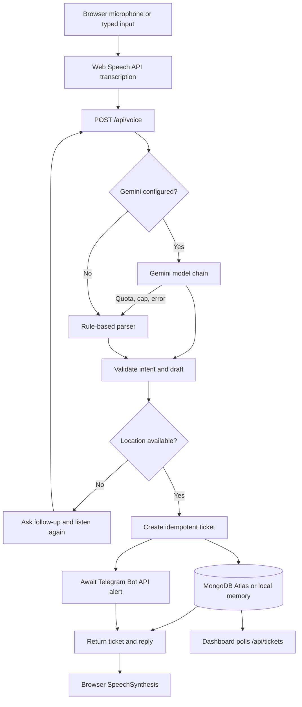

# CampusVoice

A voice-first campus grievance desk built for a public hackathon demo. Students can speak or type a complaint, provide a missing location in a follow-up, receive a ticket number, check ticket status, and hear the response. Administrators can resolve tickets with a PIN.

## What happens when a student reports an issue



## Real integrations vs fallback behavior

| Capability | When configured/supported | Without configuration/support |
|---|---|---|
| Speech-to-text | Browser Web Speech API | Always-visible typed input |
| Voice response | Browser SpeechSynthesis | Text reply remains visible |
| Intent extraction | Gemini REST model chain; optional Gemma | Deterministic rule-based parser |
| Ticket persistence | MongoDB Atlas | In-memory storage locally/tests only |
| Production database | MongoDB required | API returns 503; it never silently uses memory |
| Alerts | Telegram Bot API sendMessage | Ticket is still saved; alert status is `not_configured` or `failed` |
| Dashboard | Real ticket records from the API | Empty state when there are no tickets |

The frontend status strip reports the current backend integration state. Browser microphone and speech output support are browser-dependent.

## Requirements

- Node.js 20 or newer
- npm
- A modern browser (Chrome recommended for Web Speech API)
- Optional: Gemini API key, MongoDB Atlas URI, Telegram bot and channel/chat, admin PIN

## Local setup

```bash
npm install
cp .env.example .env.local
npm test
npm run build
npm run dev
```

On Windows PowerShell, copy the environment template with:

```powershell
Copy-Item .env.example .env.local
```

Open [http://localhost:3000](http://localhost:3000). The Express API runs on port 5000 and Vite proxies `/api` to it. No API keys are required for local development: the rule-based parser and in-memory store are used when credentials are absent.

## Environment variables

All values are optional for local development. Add secrets to `.env.local` locally and to the Vercel project's Environment Variables for deployment. Never put secrets in `VITE_*` variables.

| Variable | Purpose | Default |
|---|---|---|
| `GEMINI_API_KEY` | Google AI Studio API key | empty (rules only) |
| `GEMINI_MODEL_CHAIN` | Comma-separated Gemini model IDs in preference order | `gemini-3.1-flash-lite,gemini-3.5-flash-lite` |
| `GEMMA_MODEL` | Optional exact Gemma API model ID; empty skips Gemma | empty |
| `LLM_DAILY_CAP_PER_MODEL` | Per-model daily request cap for non-Gemma models (UTC) | `450` |
| `MONGODB_URI` | MongoDB Atlas connection string | empty |
| `MONGODB_DB` | Database name | `campusvoice` |
| `TELEGRAM_BOT_TOKEN` | Bot token from Telegram's @BotFather | empty |
| `TELEGRAM_CHAT_ID` | Channel username such as `@campus_alerts` or numeric chat ID | empty |
| `ADMIN_PIN` | PIN required to resolve tickets | empty (resolve disabled) |
| `RATE_LIMIT_PER_MIN` | Requests per IP per fixed minute | `40` |
| `RATE_LIMIT_PER_DAY` | Requests per IP per fixed UTC day | `1000` |
| `VITE_TELEGRAM_CHANNEL_URL` | Public channel URL displayed in the UI | empty |

### Where to get credentials

- **Gemini:** create an API key in [Google AI Studio](https://aistudio.google.com/app/apikey). Confirm model IDs available to your account with `npm run smoke`; availability and quotas can vary by account.
- **MongoDB:** create a free/shared cluster in [MongoDB Atlas](https://cloud.mongodb.com), create a database user, allow the deployment network, and copy the Node.js connection string.
- **Telegram:** create a bot through [@BotFather](https://t.me/BotFather), add it to the target channel with permission to post, and use the channel ID/username as `TELEGRAM_CHAT_ID`.
- **Admin PIN:** choose a private PIN and set it as `ADMIN_PIN`. Do not share it with students.
- **Public channel URL:** set the public Telegram channel link in `VITE_TELEGRAM_CHANNEL_URL`. This is public frontend configuration, not a secret.

## Commands

| Command | Purpose |
|---|---|
| `npm run dev` | Start Express and Vite locally |
| `npm test` | Run offline parser, validator, LLM-state and API integration tests |
| `npm run build` | Build the static frontend into `dist/` |
| `npm run preview` | Preview the built frontend |
| `npm run seed` | Idempotently create three sample tickets in MongoDB |
| `npm run smoke` | Independently check configured Gemini, MongoDB, Telegram and admin settings |
| `npm run test:remote` | Run deployed API checks against `BASE_URL` |

Remote test examples:

```bash
BASE_URL=https://your-project.vercel.app npm run test:remote
```

PowerShell:

```powershell
$env:BASE_URL = "https://your-project.vercel.app"
npm run test:remote
```

The smoke command prints PASS, FAIL or SKIPPED for each integration. It prints available model IDs but never prints secret values. The MongoDB smoke check creates and deletes a temporary document and increments the ticket counter, so it can consume one ticket number.

## API

- `GET /api/health` — integration health and per-model quota/circuit-breaker state; no secrets.
- `POST /api/voice` — parse a voice/text utterance, continue a missing-location conversation, check status, or create an idempotent ticket.
- `GET /api/tickets` — latest 30 public-safe tickets.
- `POST /api/tickets/:ticketNumber/resolve` — resolve with the `x-admin-pin` header.

Ticket categories map to departments and priority maps to SLA: critical 2h, high 8h, medium 24h, low 72h. Ticket numbers use an atomic MongoDB counter. Duplicate request IDs return the original ticket.

## LLM quota behavior

The server tries `GEMINI_MODEL_CHAIN` in order, then `GEMMA_MODEL` when configured, then the fallback parser. Each model has an independent UTC daily cap: 450 by default for Gemini models and 5000 for Gemma. HTTP 429/quota errors open a 60-second circuit breaker and immediately move to the next model. Three quota failures within ten minutes block that model until UTC midnight. A short (eight words or fewer) answer to a pending location question is handled deterministically without an LLM request.

Gemini receives system instructions and JSON response mode. Gemma receives the instructions and schema inside the user message, without relying on system-instruction or JSON-mode support; its first JSON object is extracted and all fields are validated server-side.

## Deployment to Vercel

1. Push the repository to GitHub yourself.
2. Import the repository in Vercel.
3. Use the default Vite build command `npm run build` and output directory `dist`.
4. Add the required server environment variables in Vercel. Set `NODE_ENV=production` only if needed; Vercel also sets `VERCEL`.
5. Ensure `MONGODB_URI` points to an Atlas cluster reachable from the deployment.
6. Deploy from the Vercel dashboard.
7. Open the public URL on a second device and follow the manual checklist in [HANDOFF.md](./HANDOFF.md).

The Express application is exported from `api/index.js` as one serverless function. `vercel.json` routes `/api/*` to that function and sets a 30-second maximum duration.

## Known limitations and risks

- Web Speech API support, microphone permission and voice availability depend on the visitor's browser/device. HTTPS is required outside localhost.
- Google model IDs and free-tier quotas are controlled by Google and can change. The configured defaults must be verified with your own key using the smoke check.
- MongoDB is required in production. If it is missing or unreachable, the API reports database-down and ticket creation returns 503.
- Telegram delivery is attempted before the API responds. A Telegram failure does not roll back a created ticket; the ticket records the alert status.
- The dashboard intentionally exposes the latest ticket details to public visitors. Do not put sensitive personal or medical details in a complaint.
- Admin PIN is a simple shared-secret demo control, not a full identity/role system. Use HTTPS and a strong PIN.
- CampusVoice is a hackathon demonstration, not an emergency-response channel. Contact campus security/emergency services directly for urgent danger.
